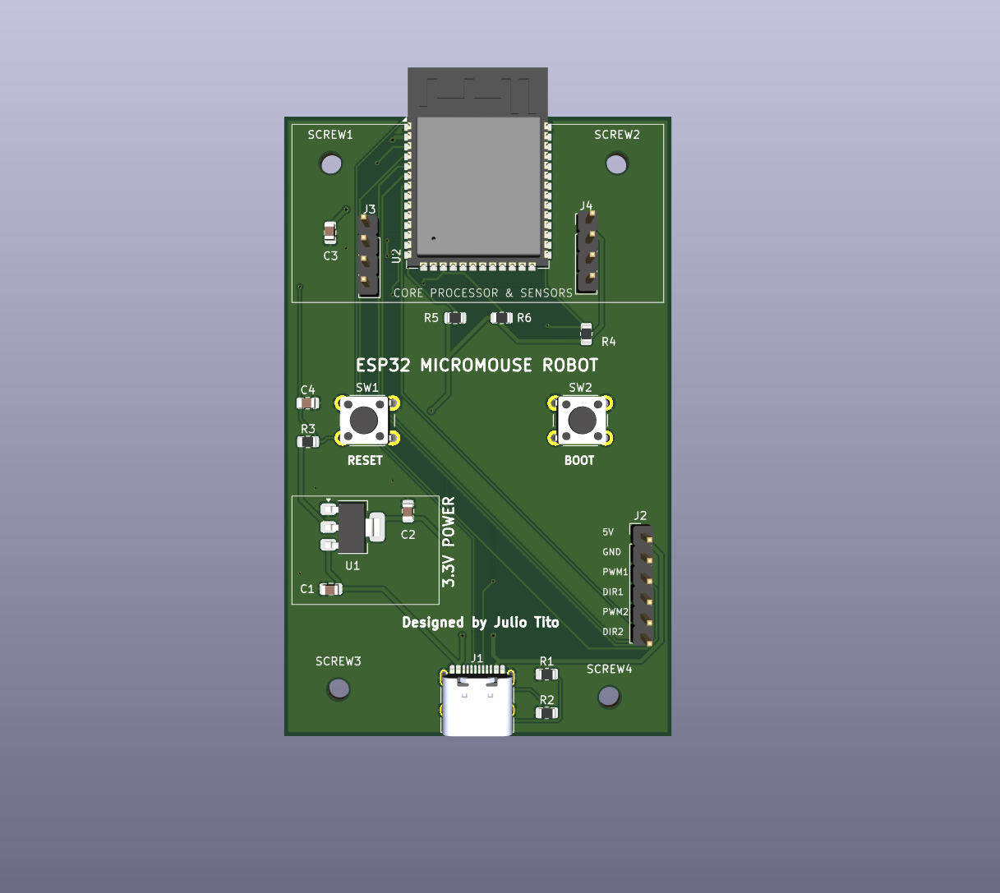
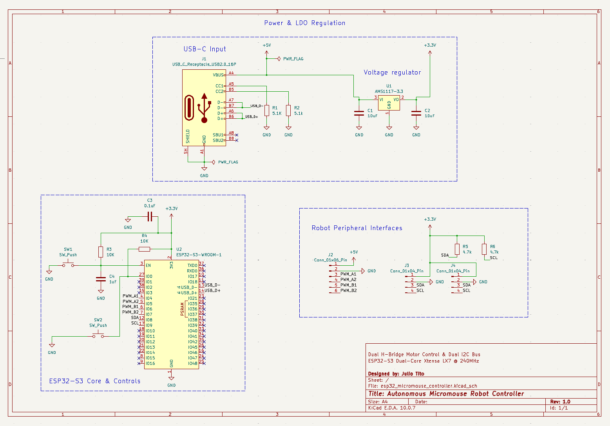
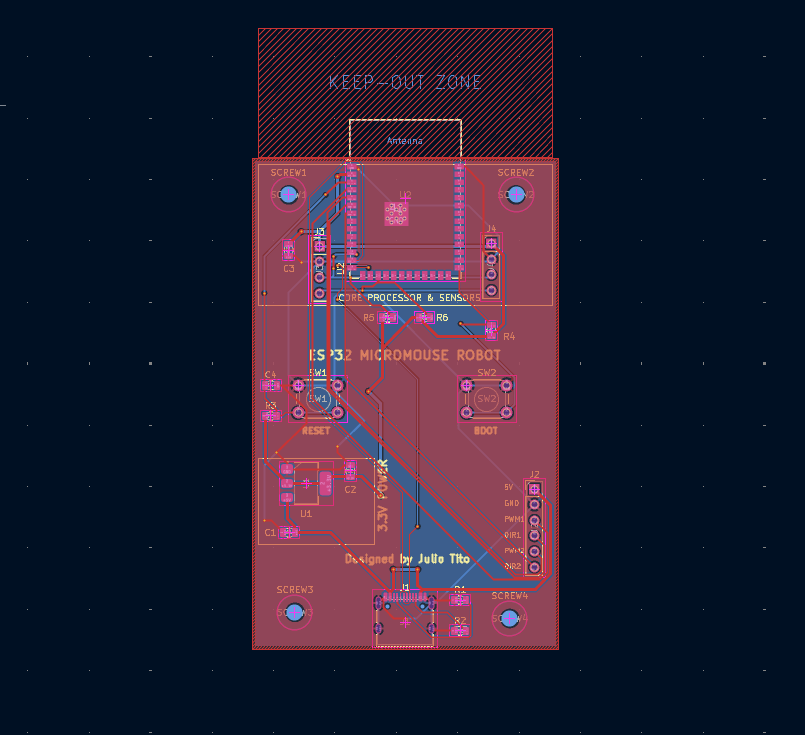

# ESP32-S3 Micromouse Robot Controller

A compact robotics breakout and control PCB designed for an autonomous maze-solving Micromouse robot. The board integrates power regulation, dual distance sensor interfaces, and motor driver breakouts around an ESP32-S3 system.

  

## Features

- **ESP32-S3 Core Module**
  - Surface-mount ESP32-S3-WROOM-1 footprint with dedicated antenna keep-out area
  - Native USB D+/D- lines routed to GPIO 19 and 20 for firmware flashing and debugging

- **Dual I2C Distance Sensor Breakouts**
  - Dual 4-pin headers (J3, J4) for left and right Time-of-Flight / IR obstacle sensors
  - Integrated 4.7k pull-up resistors on SDA and SCL lines

- **Dual DC Motor Driver Interface**
  - 6-pin header (J2) providing 5V, GND, dual PWM speed channels, and direction pins for an external H-bridge

- **USB-C Power Input & 3.3V Regulation**
  - 16-pin USB Type-C receptacle with dual 5.1k CC pull-down resistors for standard 5V supply
  - Onboard AMS1117-3.3 linear regulator with 10uF input/output ceramic filtering capacitors

- **Hardware Control Switches**
  - Tactile pushbuttons for RESET and BOOT mode selection with RC filtering and pull-ups

- **Chassis Mounting**
  - 4x M2.5 screw mounting holes with dedicated copper clearance for robot mechanical framing

## Schematic & Layout

Schematic:

  

[Download Schematic PDF](Media/esp32_micromouse_schematic.pdf)

PCB Layout:

  

## Skills Demonstrated

- KiCad 10 schematic capture and 2-layer PCB layout routing
- Complete Design Rule Check (DRC) verification with 0 errors and 0 parity warnings
- SMT footprint routing (ESP32-S3, USB-C, 0805 passives, SOT-223)
- Continuous ground plane flooding and thermal relief connections
- Functional silkscreen documentation with circuit grouping outlines and header pinouts
- Fabrication data generation (RS-274X Gerbers, Excellon NC drill files)

## Key Components & Footprints

| Designator | Component | Footprint / Package | Function |
| :--- | :--- | :--- | :--- |
| U1 | AMS1117-3.3 | SOT-223 | 5V to 3.3V LDO regulator |
| U2 | ESP32-S3-WROOM-1 | SMD Module | Main system microcontroller |
| J1 | USB-C Receptacle | 16-Pin SMD | 5V power and USB data |
| J2 | Pin Header 1x06 | 2.54 mm Pitch TH | Motor driver interface |
| J3, J4 | Pin Header 1x04 | 2.54 mm Pitch TH | Left and right I2C distance sensors |
| SW1, SW2 | Tactile Switch | 6x6 mm Pushbutton | RESET and BOOT triggers |
| R1, R2 | 5.1k Resistor | 0805 SMD | USB-C CC line pull-downs |
| R3, R4 | 10k Resistor | 0805 SMD | EN and BOOT pull-up network |
| R5, R6 | 4.7k Resistor | 0805 SMD | I2C SDA and SCL bus pull-ups |
| C1, C2 | 10uF Capacitor | 0805 SMD | LDO input and output decoupling |
| C3, C4 | 0.1uF / 1uF Capacitor | 0805 SMD | Power rail filtering and reset debounce |

## File Formats

- Hardware_Files/ contains editable KiCad project, schematic, and board layout files
- Gerbers_Micromouse_v1.0.zip contains generated fabrication Gerber and drill files for PCB manufacturing
- 3D Models/ contains component 3D step and wrl models used for rendering
- Media/ contains board layouts, schematic exports, and 3D renders

## Author

Julio Tito  
Rutgers University – New Brunswick  
B.S. in Electrical and Computer Engineering
