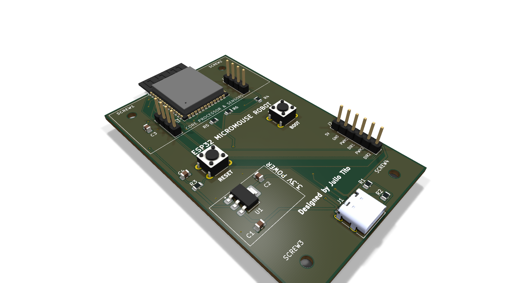
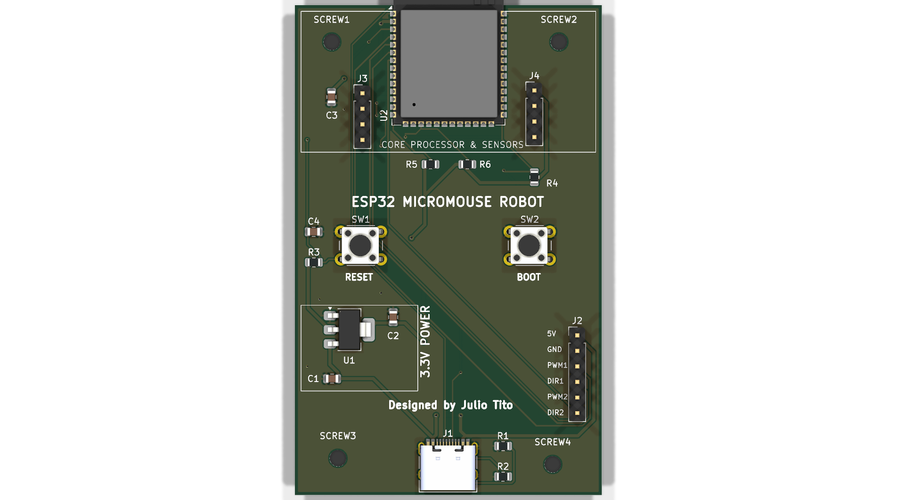
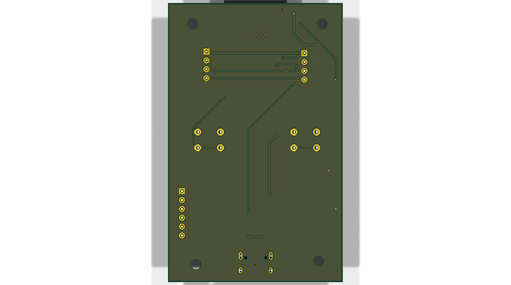
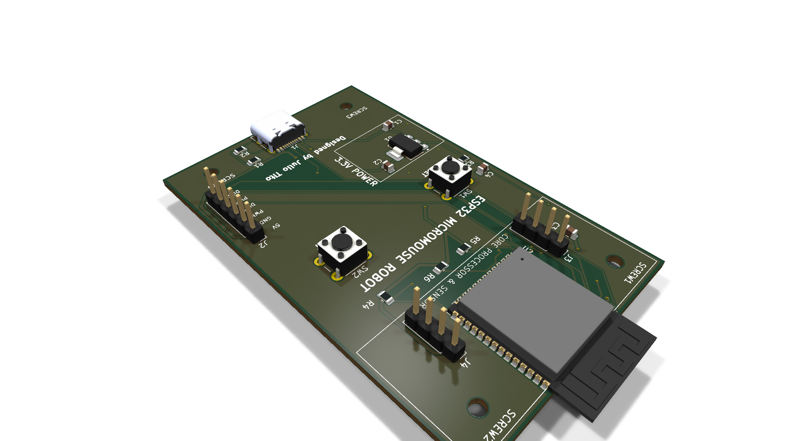
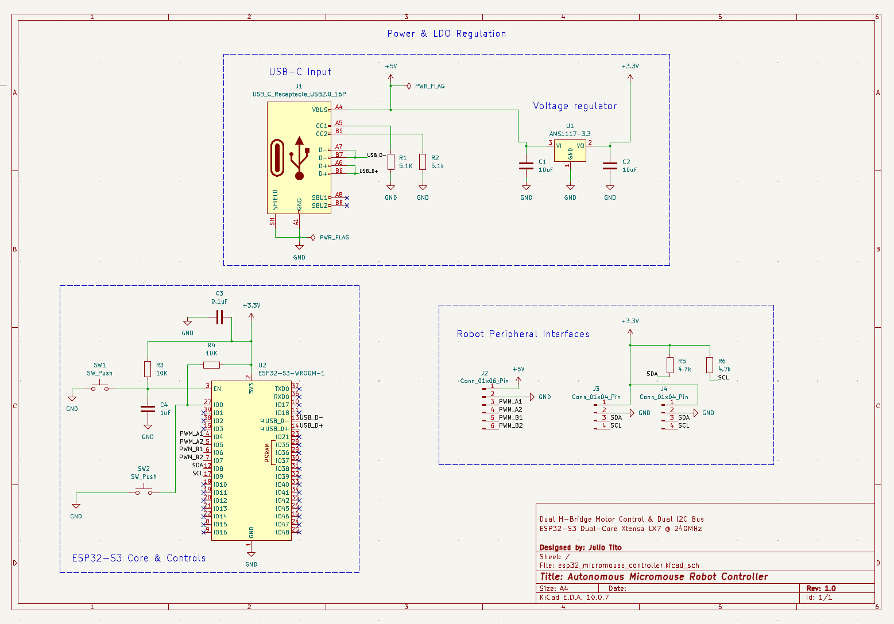
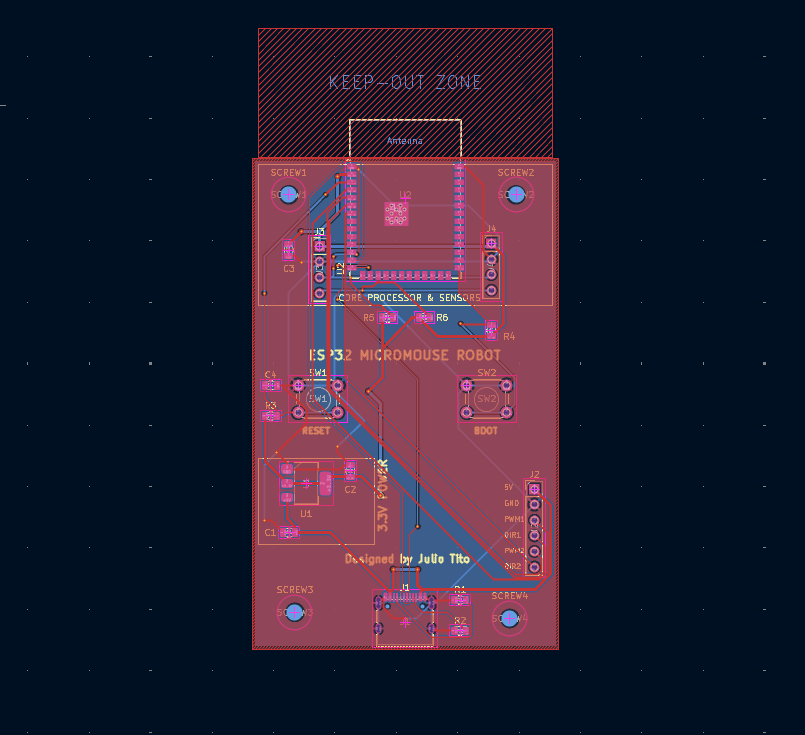

# ESP32-S3 Micromouse Robot Controller (KiCad 10)

<p align="left">
  
  
  
  
  
  
</p>

A custom, compact (**50 mm × 80 mm**) robotics controller and sensor breakout PCB engineered for autonomous maze-solving **Micromouse** robots. Designed in **KiCad 10**, the board integrates dual Time-of-Flight / IR distance sensor interfaces, a dual DC motor driver header, USB-C power delivery, and an onboard 3.3V LDO regulator around an **ESP32-S3-WROOM-1** high-performance dual-core microcontroller.

> [!NOTE]
> **Looking for advanced high-speed multi-layer PCB design?**  
> Check out my [**4-Layer High-Speed CM4 Carrier Board**](https://github.com/JulioxTito/CM4_highspeed_Carrier_PCB) — featuring PCIe Gen 2.0 (5.0 Gbps), M.2 Key-M NVMe storage, 4K HDMI, and 4-layer controlled-impedance differential routing.

---

## 📸 3D Hardware Renders & Board Gallery

<p align="center">
  
  <br>
  <em>Figure 1: High-resolution raytraced 3D isometric perspective showing the ESP32-S3 module, USB-C port, LDO regulator, and peripheral headers.</em>
</p>

<p align="center">
  
  
  <br>
  <em>Figure 2: (Left) Top orthogonal assembly layout. (Right) Bottom ground plane flood with thermal relief spoke connections and isolation clearances.</em>
</p>

<p align="center">
  
  <br>
  <em>Figure 3: Rear isometric perspective illustrating chassis mounting clearances, motor driver header, and sensor breakouts.</em>
</p>

---

## 🚀 Key Hardware Features

* **ESP32-S3 Core Processing Subsystem:**
  * Surface-mount **ESP32-S3-WROOM-1** module (Xtensa® 32-bit LX7 dual-core @ up to 240 MHz).
  * Dedicated RF keep-out zone under the PCB trace antenna to prevent wireless signal attenuation.
  * Direct routing of native USB D+/D- lines to GPIO 19 and GPIO 20 for CDC serial debugging, JTAG bring-up, and USB firmware flashing.
* **Dual Time-of-Flight / I2C Distance Sensor Breakouts:**
  * Dedicated left (`J3`) and right (`J4`) 4-pin headers for obstacle detection and maze wall following.
  * Onboard 4.7 kΩ bus pull-up resistors on SDA and SCL lines.
* **Dual DC Motor Driver Interface:**
  * 6-pin high-current interface header (`J2`) providing raw 5V, GND, dual PWM speed control channels (`PWM1`, `PWM2`), and dual directional control lines (`DIR1`, `DIR2`) for an external H-bridge module.
* **Power Delivery Network (PDN):**
  * Robust 16-pin USB Type-C receptacle (`J1`) with dual 5.1 kΩ CC pull-down resistors for standard 5V supply negotiation.
  * Onboard **AMS1117-3.3** linear voltage regulator supplying up to 800 mA continuous current to the 3.3V system rail.
  * Multi-tier capacitor filtering matrix (10 µF bulk ceramic capacitors + 0.1 µF decoupling capacitors adjacent to IC power pins).
* **Hardware Control & Programming:**
  * Tactile pushbuttons for synchronous hardware `RESET` and `BOOT` mode entry with RC debounce networks and pull-ups.
* **Mechanical Framing & Mounting:**
  * 4x M2.5 screw mounting holes positioned at the board corners with isolated annular copper ring clearances for secure attachment to the robot chassis.

---

## 📐 PCB Fabrication & Manufacturing Specifications

| Parameter | Specification | Manufacturing Details |
| :--- | :--- | :--- |
| **Board Dimensions** | **50.0 mm × 80.0 mm** | Standard micromouse chassis form factor |
| **Layer Count** | **2 Layers (Top / Bottom)** | FR4 standard dielectric |
| **Finished Thickness** | **1.6 mm** | Standard mechanical rigidity |
| **Copper Weight** | **1 oz (35 µm)** | Top and bottom layers |
| **Minimum Trace Width** | **8 mil (0.20 mm)** | Signal and telemetry buses |
| **Power Bus Width** | **20–30 mil (0.50–0.75 mm)** | 5V and 3.3V high-current feeds |
| **Minimum Clearance** | **8 mil (0.20 mm)** | Trace-to-trace and trace-to-pad |
| **Minimum Drill Size** | **0.30 mm** | 0.60 mm annular ring for vias |
| **Solder Mask** | **Green** | Top and bottom liquid photoimageable |
| **Silkscreen** | **White** | High-contrast component identifiers & pin legends |
| **Surface Finish** | **HASL Lead-Free** | Lead-free solder finish (RoHS compliant) |
| **DRC Verification** | **0 Errors / 0 Warnings** | 100% Design Rule Check signoff in KiCad 10 |

---

## 🔌 Hardware Pinout & Interface Mapping

| Interface Header | Pin | Signal Net | Function Description |
| :--- | :---: | :--- | :--- |
| **J1 (USB Type-C)** | 1, 12, 13, 24 | `GND` | Power ground return |
| | 4, 9, 16, 21 | `+5V` | 5V VBUS power rail |
| | 5, 17 | `CC1`, `CC2` | 5.1kΩ configuration channel pull-downs |
| | 6, 7 | `USB_D+`, `USB_D-` | Native USB communication to ESP32-S3 (GPIO 20 / GPIO 19) |
| **J2 (Motor Interface)** | 1 | `+5V` | Direct VBUS power feed for motor drivers |
| | 2 | `GND` | Motor return ground |
| | 3 | `PWM1` | Motor A speed PWM output |
| | 4 | `DIR1` | Motor A direction control signal |
| | 5 | `PWM2` | Motor B speed PWM output |
| | 6 | `DIR2` | Motor B direction control signal |
| **J3 (Left Sensor)** | 1 | `+3.3V` | 3.3V regulated power rail |
| | 2 | `GND` | Sensor ground |
| | 3 | `SDA` | I2C serial data line (4.7kΩ pull-up) |
| | 4 | `SCL` | I2C serial clock line (4.7kΩ pull-up) |
| **J4 (Right Sensor)**| 1 | `+3.3V` | 3.3V regulated power rail |
| | 2 | `GND` | Sensor ground |
| | 3 | `SDA` | I2C serial data line (4.7kΩ pull-up) |
| | 4 | `SCL` | I2C serial clock line (4.7kΩ pull-up) |
| **SW1 (Tactile)** | -- | `RESET` | Hardware reset (`CHIP_PU`) with pull-up & RC debounce |
| **SW2 (Tactile)** | -- | `BOOT` | GPIO 0 boot mode selection switch |

---

## 📑 Schematic & PCB Layout

### Schematic Architecture
The circuit schematic integrates power regulation, decoupling, switch debouncing, and sensor breakouts:

<p align="center">
  
  <br>
  <em>Figure 4: Complete KiCad 10 schematic diagram.</em>
</p>

* 📄 **[Download Vector Schematic PDF](Media/esp32_micromouse_schematic.pdf)**

### PCB Layout & Routing
Full 2-layer routing with complete ground plane flooding on both layers:

<p align="center">
  
  <br>
  <em>Figure 5: 2-layer routed board layout showing high-current copper fills and ground thermal reliefs.</em>
</p>

---

## 🛠️ Bill of Materials (BOM)

| Designator | Component | Package / Footprint | Value / Description | Function |
| :--- | :--- | :--- | :--- | :--- |
| **U1** | AMS1117-3.3 | SOT-223 | 3.3V / 800mA LDO | System voltage step-down regulator |
| **U2** | ESP32-S3-WROOM-1 | SMD Module | Dual-Core 240MHz MCU | Central controller & wireless system |
| **J1** | USB Type-C Receptacle | 16-Pin SMD | 5V / 3A VBUS Input | Power input & USB CDC flashing |
| **J2** | Pin Header 1x06 | 2.54 mm Pitch TH | 6-Pin Interface | External H-bridge DC motor driver |
| **J3, J4** | Pin Header 1x04 | 2.54 mm Pitch TH | 4-Pin I2C Header | Left & right Time-of-Flight sensors |
| **SW1, SW2** | Tactile Switch | 6×6 mm Pushbutton | Momentary NO | Hardware `RESET` and `BOOT` switches |
| **R1, R2** | Resistor | 0805 SMD | 5.1 kΩ (1%) | USB-C CC line pull-downs |
| **R3, R4** | Resistor | 0805 SMD | 10 kΩ (1%) | `EN` / `BOOT` pull-up resistors |
| **R5, R6** | Resistor | 0805 SMD | 4.7 kΩ (1%) | I2C `SDA` and `SCL` bus pull-ups |
| **C1, C2** | Ceramic Capacitor | 0805 SMD | 10 µF (16V X7R) | LDO input and output bulk decoupling |
| **C3, C4** | Ceramic Capacitor | 0805 SMD | 0.1 µF / 1 µF | High-frequency noise suppression & debounce |

---

## 📂 Repository File Structure

```text
ESP32_Micromouse_PCB_KICAD/
├── 3D Models/                                 # Component STEP and WRL models
├── Gerbers/                                   # Production-ready manufacturing files
│   ├── esp32_micromouse_controller-B_Cu.gbr   # Bottom copper layer
│   ├── esp32_micromouse_controller-B_Mask.gbr # Bottom solder mask
│   ├── esp32_micromouse_controller-B_Paste.gbr# Bottom solder paste
│   ├── esp32_micromouse_controller-B_Silkscreen.gbr # Bottom silkscreen
│   ├── esp32_micromouse_controller-Edge_Cuts.gbr   # Board contour edge cuts
│   ├── esp32_micromouse_controller-F_Cu.gbr   # Top copper layer
│   ├── esp32_micromouse_controller-F_Mask.gbr # Top solder mask
│   ├── esp32_micromouse_controller-F_Paste.gbr# Top solder paste
│   ├── esp32_micromouse_controller-F_Silkscreen.gbr # Top silkscreen
│   └── esp32_micromouse_controller-job.gbrjob # Gerber job description
├── Gerbers_Micromouse_v1.0.zip                # Zipped fabrication bundle for JLCPCB / PCBWay
├── Hardware_Files/                            # KiCad 10 project, schematics, and board files
│   ├── esp32_micromouse_controller.kicad_pcb  # 2-layer PCB layout
│   ├── esp32_micromouse_controller.kicad_pro  # KiCad project configuration
│   └── esp32_micromouse_controller.kicad_sch  # System schematic
├── Media/                                     # High-res 3D raytraced renders & schematics
│   ├── board_iso_front.png                    # Primary 3D isometric render
│   ├── board_iso_back.png                     # Reverse angle 3D render
│   ├── board_top_3d.png                       # Top-down 3D orthogonal view
│   ├── board_bottom_3d.png                    # Bottom ground plane 3D render
│   ├── board_layout.png                       # 2D routed layout graphic
│   ├── schematic.png                          # Schematic image capture
│   └── esp32_micromouse_schematic.pdf         # Vector schematic PDF
└── README.md                                  # Complete engineering documentation
```

---

## 👤 Author

**Julio Tito**  
*Electrical & Computer Engineering | Rutgers University*  
* **LinkedIn:** [linkedin.com/in/juliotito](http://www.linkedin.com/in/juliotito)  
* **GitHub:** [github.com/JulioxTito](https://github.com/JulioxTito)  
* **Portfolio:** [Engineering Portfolio](https://github.com/JulioxTito)
